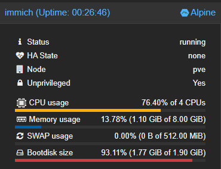
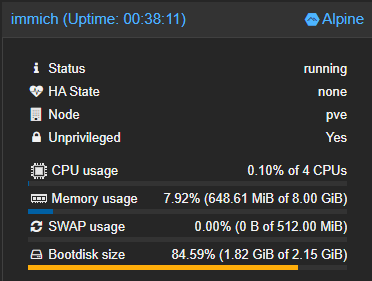
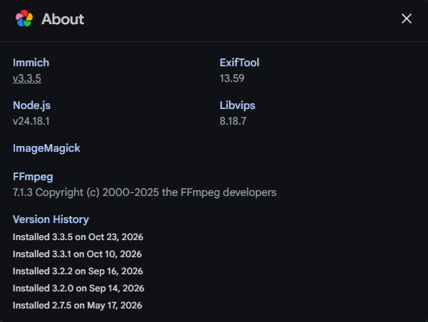

# immich-alpine
Run immich server on Alpine Linux. No building required.

This follows the immich versions for every x.y.z release. Support started from v3.3.5. Anything before that is partially
supported for before v3.3.5 and nothing before v3.2.0. You are welcome to try them out, but it won't be as simple as installing.

> [!WARNING]
> Versions `v3.2.0=>n<=v3.3.4` are pre-packaged as giant tar.gz and is now considered legacy. Please use the new install method below.

## Quick Installation (and Upgrading)
### Insecure Method
**wget**
```bash
wget -O /tmp/immich-alpine-latest.apk \
  https://immich.hombre.asia/v3.24/releases/x86_64/immich-alpine-latest.apk

apk add /tmp/immich-alpine-latest.apk --allow-untrusted
```
**curl**
```bash
curl -fL --retry 3 \
  -o /tmp/immich-alpine-latest.apk \
  https://immich.hombre.asia/v3.24/releases/x86_64/immich-alpine-latest.apk

apk add /tmp/immich-alpine-latest.apk --allow-untrusted
```
### Secure Method
Please make sure you already have the public key installed. If not, check it below.

**wget**
```bash
wget -O /tmp/immich-alpine-latest.apk \
  https://immich.hombre.asia/v3.24/releases/x86_64/immich-alpine-latest.apk

apk add /tmp/immich-alpine-latest.apk
```
**curl**
```bash
curl -fL --retry 3 \
  -o /tmp/immich-alpine-latest.apk \
  https://immich.hombre.asia/v3.24/releases/x86_64/immich-alpine-latest.apk

apk add /tmp/immich-alpine-latest.apk
```

## Advanced Installation (and Upgrading)
**wget**
```bash
# Add and trust this repository's APK public key
mkdir -p /etc/apk/keys
wget -O /etc/apk/keys/immich-alpine.pub \
  https://raw.githubusercontent.com/ronhombre/immich-alpine/refs/heads/main/key/immich-alpine.pub
chmod 0644 /etc/apk/keys/immich-alpine.pub

# Download and Install APK
wget -O /tmp/immich-alpine-latest.apk \
  https://immich.hombre.asia/v3.24/releases/x86_64/immich-alpine-latest.apk

apk add /tmp/immich-alpine-latest.apk

# In the future, you don't have to download the public key again.
```
**curl**
```bash
# Add and trust this repository's APK public key
mkdir -p /etc/apk/keys
curl -fsSL \
  'https://raw.githubusercontent.com/ronhombre/immich-alpine/refs/heads/main/key/immich-alpine.pub' \
  -o /etc/apk/keys/immich-alpine.pub
chmod 0644 /etc/apk/keys/immich-alpine.pub

# Download and Install APK
curl -fL --retry 3 \
  -o /tmp/immich-alpine-latest.apk \
  https://immich.hombre.asia/v3.24/releases/x86_64/immich-alpine-latest.apk

apk add /tmp/immich-alpine-latest.apk

# In the future, you don't have to download the public key again.
```

The purpose of this public key is for you to maintain a consistent validation of trust between you and me, the maintainer
of this package method. You should be able to validate implicitly that the APK genuinely comes from me and is most likely
built using GitHub Actions and is not implanted with malware. You are also free to not install the public key as long as
you understand the risks.

## Example (Working)


In this setup, I'm using [proxmox](https://www.proxmox.com/) to run the server in an unprivileged container. As seen in
figures above, the server is using significantly less memory than the immich-native version. This was what I wanted and
the main reason I started this project.

This uses a mounted 72GB volume for the files, and another VM for Postgres and Redis.

Looking at this, it might be a good idea to separate the machine-learning app from the main server, but that is a
project for a future me.

## Example (Upgrade path)


I have successfully upgraded from v3.3.1 to v3.3.5

## How this works
- `.github/workflows/build-immich.yml` builds immich for the current release and attaches the artifacts to the release.
- `build-immich-alpine.sh` builds immich from source in an Alpine Linux container and generates a signed APK.

## FAQ
- **Q:** My install/upgrade failed and I want to restore.

**A:** The backups are typically stored at `/var/lib/immich/backups`. You can manually move them back to `/var/lib/immich/app` or symlink if you're lazy.

## Verify the built APK using GitHub CLI (Attestation)
First install GitHub CLI before running the command.
### Install and Login to GitHub CLI
```bash
apk update
apk add github-cli

gh auth login
```

### Run Attestation
```bash
gh attestation verify immich-alpine-3.3.5-r1.apk -R ronhombre/immich-alpine
```

### Example Attestation Output
```
~ # gh attestation verify immich-alpine-3.3.5-r1.apk -R ronhombre/immich-alpine
Loaded digest sha256:f74da41b4d1e4344995216eef0fbe587018ce5630b455f3594a3e547c8766d90 for file://immich-alpine-3.3.5-r1.apk
Loaded 1 attestation from GitHub API

The following policy criteria will be enforced:
- Predicate type must match:................ https://slsa.dev/provenance/v1
- Source Repository Owner URI must match:... https://github.com/ronhombre
- Source Repository URI must match:......... https://github.com/ronhombre/immich-alpine
- Subject Alternative Name must match regex: (?i)^https://github\.com/ronhombre/immich-alpine/
- OIDC Issuer must match:................... https://token.actions.githubusercontent.com

✓ Verification succeeded!

The following 1 attestation matched the policy criteria

- Attestation #1
  - Build repo:..... ronhombre/immich-alpine
  - Build workflow:. .github/workflows/build-immich.yml@refs/heads/main
  - Signer repo:.... ronhombre/immich-alpine
  - Signer workflow: .github/workflows/build-immich.yml@refs/heads/main
```
This verifies the binary further that it's built openly using this repository and the `build-immich.yml` workflow.

> [!CAUTION]
> If this fails in any way, DO NOT INSTALL! You have been warned. All APK builds in the
> [releases](https://github.com/ronhombre/immich-alpine/releases) page should always succeed.

## References
- Heavily inspired by [arter97/immich-native](https://github.com/arter97/immich-native). I made this because I wanted to
run Immich on Alpine Linux and reduce the memory footprint. I also hated having to build the server myself every time.

## License
This license strictly applies to the GitHub Workflow config, build script, and install script. It does not mean I am
claiming license ownership of the built artifacts. That still solely depends on Immich's license.
```text
MIT License

Copyright (c) 2026 Ron Lauren Hombre

Permission is hereby granted, free of charge, to any person obtaining a copy
of this software and associated documentation files (the "Software"), to deal
in the Software without restriction, including without limitation the rights
to use, copy, modify, merge, publish, distribute, sublicense, and/or sell
copies of the Software, and to permit persons to whom the Software is
furnished to do so, subject to the following conditions:

The above copyright notice and this permission notice shall be included in all
copies or substantial portions of the Software.

THE SOFTWARE IS PROVIDED "AS IS", WITHOUT WARRANTY OF ANY KIND, EXPRESS OR
IMPLIED, INCLUDING BUT NOT LIMITED TO THE WARRANTIES OF MERCHANTABILITY,
FITNESS FOR A PARTICULAR PURPOSE AND NONINFRINGEMENT. IN NO EVENT SHALL THE
AUTHORS OR COPYRIGHT HOLDERS BE LIABLE FOR ANY CLAIM, DAMAGES OR OTHER
LIABILITY, WHETHER IN AN ACTION OF CONTRACT, TORT OR OTHERWISE, ARISING FROM,
OUT OF OR IN CONNECTION WITH THE SOFTWARE OR THE USE OR OTHER DEALINGS IN THE
SOFTWARE.
```
